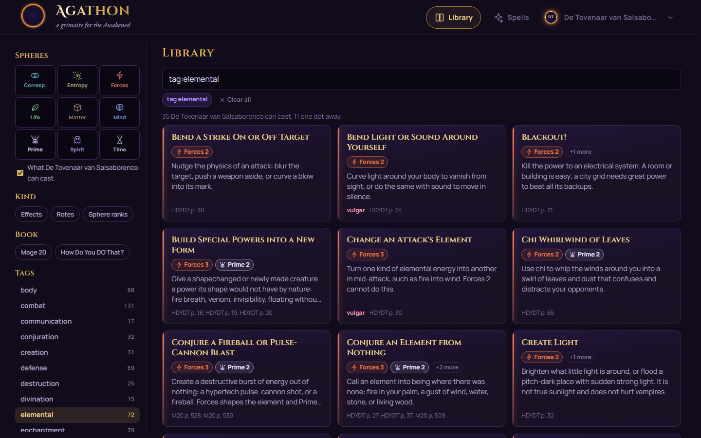
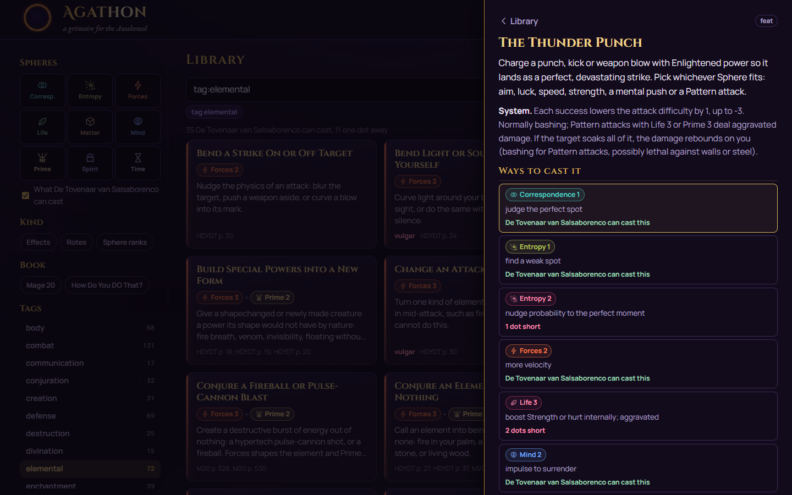
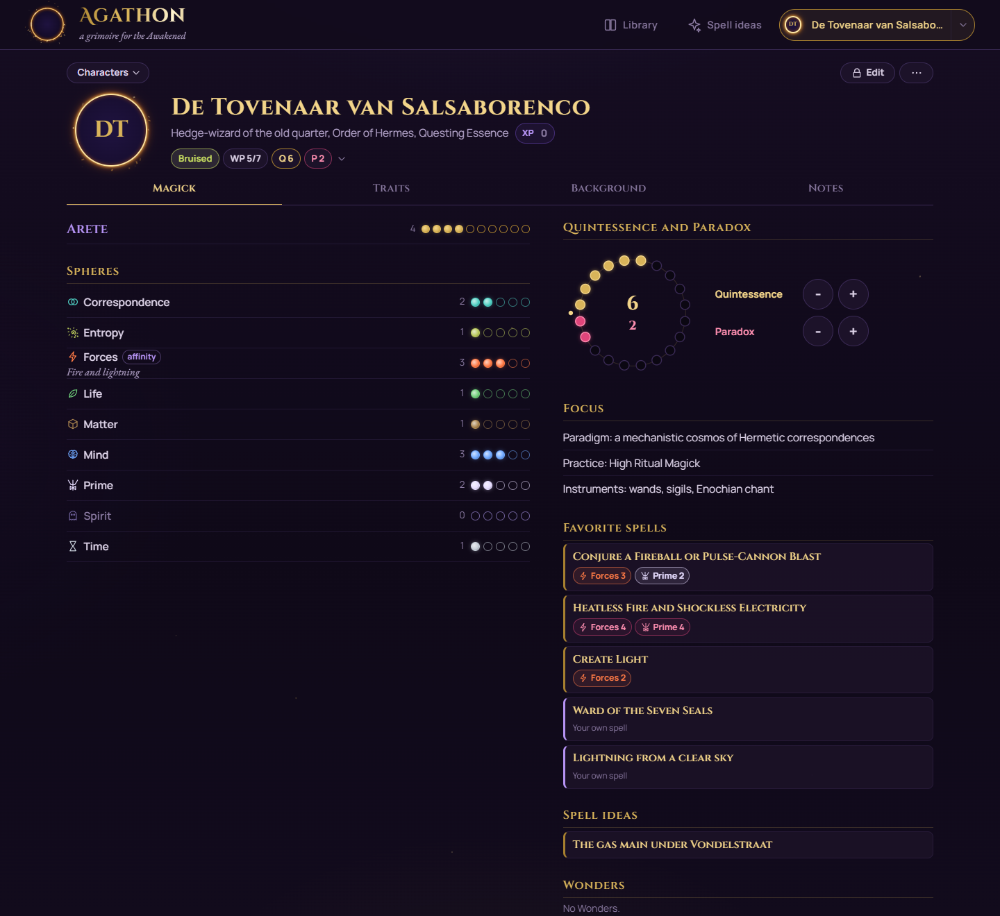
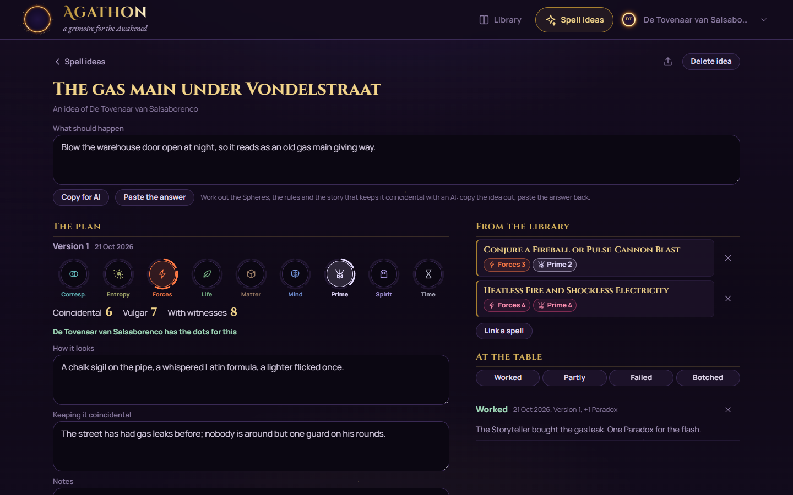
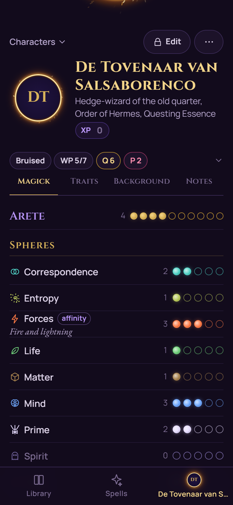
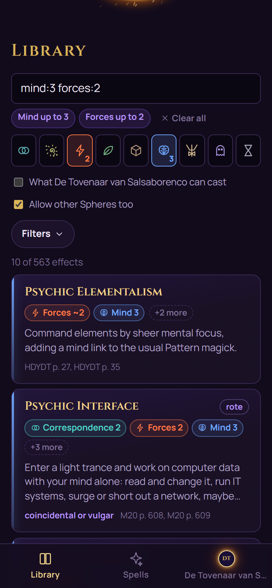
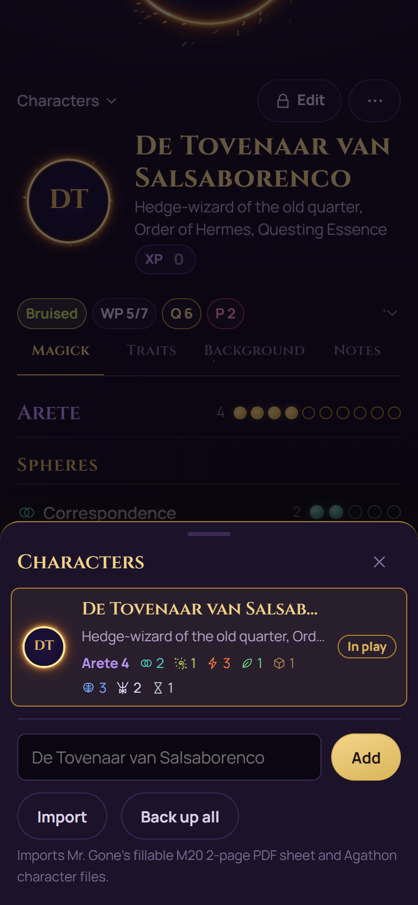

# Agathon: a grimoire for the Awakened

An installable, offline-first companion for **Mage: The Ascension 20th Anniversary**:
a searchable library of **563 spells** from the books, full **character sheets** you
can import from (and export back to) your PDF sheet, **spell ideas** you can work out
and think through with your own AI, and sharing with your table. Rolls stay on the
table; Agathon is the helper and sounding board.

**Live: [agathon.pages.dev](https://agathon.pages.dev)**









<details>
<summary>On a phone</summary>

<p>
  
  
  
</p>

</details>

## Features

### Library

- **Every spell from both books**: the Sphere rank lists, the worked examples and the
  named rotes of *Mage 20* and *How Do You DO That?*, each with its Sphere
  combinations, alternatives, add-ons and book/page references. The summaries are
  our own words; no book text ships with the app.
- **Search by Sphere combination**: tap Spheres in the bar (or type `mind:3
  forces:2`) to find spells that use exactly that combination. "Allow other
  Spheres" or `uses:mind,forces` widens it.
- **What can my character cast**: one switch splits the list into what the active
  character can cast right now and what is **one dot away**, with the missing
  Sphere marked.
- **Search words are marked** in the cards and the detail; when they only occur
  further down a spell, a line from there shows why it matched.
- **Operators** for keyboard search: `tag:healing`, `book:hdydt`, `kind:rote`,
  `is:vulgar`, `is:fav` (your favorites), `name:portal`, rank forms `=3`, `3+`, `2-4`, the Technocratic names
  (`data:`, `primal:`, `dimsci:`), and `-` to exclude anything.
- **Share a spell**: the button next to the star shares a link (the share sheet on a
  phone, copied on a desktop) that shows the spell's name and summary as a preview in
  WhatsApp, Discord and the like, and opens the spell in Agathon.
- **Spell detail**: every way to cast it, the base difficulty (highest Sphere +3
  coincidental, +4 vulgar, +5 with witnesses, M20 p. 501), what the book says about
  keeping it coincidental, and a checklist of mitigation tricks that light up when
  your character has the Spheres for them. A star makes it a favorite; "Start a
  spell idea from this" turns it into a spell idea.

### Characters

- **The full M20 sheet**: Attributes, Abilities, Spheres with specialties and the
  affinity Sphere, Arete, Backgrounds, Merits and Flaws, Focus, favorite spells,
  Wonders, experience, history, description, gear and weapons, and a full-height
  notebook for notes.
- **Play mode and edit mode**: while playing only health, Willpower and the
  **Quintessence/Paradox wheel** change (Paradox cancels Quintessence, never the
  other way round, as in M20), plus the experience beside the name; a lock switches
  to editing. The health status runs from green (unhurt) through yellow and orange to
  red as the wound penalties climb.
- **PDF import and export**: drop in Mr. Gone's fillable M20 2-page sheet and every
  field comes across, including the portrait pasted into it. Re-importing shows the
  changes first and keeps your notes. "Export PDF sheet" fills your own PDF back in,
  portrait included (a new one from the app replaces the old picture), and the result
  stays fillable in Acrobat Reader. Characters made in the app use Mr. Gone's free
  blank sheet: the first export fetches it from his site, once per device.
- **Pick lists**: Concept, Essence, Nature, Demeanor, Affiliation, Sect, Backgrounds,
  Merits, Flaws and the Focus (paradigm, practice, instruments) come from searchable
  lists of what M20 defines, with a short hint,
  the cost and the page; your own names work too. Specialties suggest M20's examples
  as you type.
- **Portraits** in a small sparking portal, enlarged with a tap, replaceable in edit
  mode.
- **Favorite spells** (what M20 sheets call rotes): tap the star on a spell in the
  library and it waits on the sheet's Magick tab, opening right there; spells of your
  own sit in the same list. They go in and out of the PDF sheet's rotes fields.
- **Copy character** (in the sheet's menu): a full copy with its PDF and spell ideas,
  to try out a build without touching the original.
- **One character in play**: the nav carries the active character, one tap opens
  the sheet. The character switcher (the caret beside it on a wide screen, or
  "Characters" on the sheet) lists the others and adds or imports new ones.

### Spell ideas

- **Spell ideas** per character: what you want to happen, the library spells it
  builds on, and the plan: Spheres (with the base difficulty and whether your
  character has the dots), how it looks, how to keep it coincidental. "Try another
  way" keeps the old plan as an earlier version.
- **At the table**: log how a casting went (worked, partly, failed, botched) and the
  Paradox it cost.
- Start one by name, or from any spell in the library.
- **Share a spell idea**: the link carries the idea and its plans (not the log), shows
  its title and goal as a preview card, and adds a copy to the other player's characters.
- **Work it out with an AI**: Copy for AI gathers everything needed to work a spell
  out (your mage, the idea and its plan, the spells it builds on, the rules, your
  scene or question) into one prompt for Claude, ChatGPT or Gemini. Paste the answer
  back and its plan becomes a new version of the idea; its suggested name (short, snappy,
  funny) and its wording of what should happen can be taken over with a tick.
- **The rules from your own books**: add your PDF of the M20 core book or How Do You
  DO That? and your spell ideas can lean on the book itself: the pages of the spells
  an idea builds on, its Sphere ranks, and the casting and Paradox rules. The text
  stays on your device; save it as a file to move it to your phone.

### Sharing

- One character as a **file, link or QR code**, or a backup of all of them. Notes
  stay private unless you tick them; links carry a small portrait, files the full
  one. Imports only ever add: a name that already exists gets a number.

### App

- **Fully offline** once loaded, installable on phone and desktop, with a "new
  version ready" prompt after each deploy. Works on narrow phones down to 320px,
  file pickers included.
- Everything you enter stays in your browser (IndexedDB) until you share it.

## Commands

```sh
npm install
npm run dev      # local dev server (localhost:5173)
npm run build    # production build -> dist/
npm run preview  # serve the production build (localhost:4173)
npm run deploy   # build + deploy to Cloudflare Pages (project "agathon")
npm run icons    # PNG app icons from public/icons/sigil.svg
node scripts/sigil.mjs   # regenerate the portal icon itself
```

Spell library (the generated `library/effects.json` is committed; the build does
not run these; see [library/README.md](library/README.md)):

```sh
node library/scripts/extract-text.mjs   # once: book text from your own PDFs into refs/text (gitignored)
node library/scripts/build.mjs          # library/src/*.json -> library/effects.json
node library/scripts/check.mjs          # checks every entry against the book text; must end in "OK: 0 issues"
```

Checks and screenshots (headless system Edge via playwright-core; start
`npm run preview` first, or set `BASE=https://agathon.pages.dev`):

```sh
node scripts/verify.mjs           # shell, navigation, IndexedDB, character switcher, pick lists, Android pickers, 320px edit mode, broken links, idle CPU, offline
node scripts/verify-sheet.mjs     # PDF import via the UI, portrait, trackers, edit mode, XP, favorites, export round trip, copies, the blank sheet
node scripts/verify-share.mjs     # link, QR and file, a second device, name clashes, damaged, hostile and oversized links
node scripts/verify-library.mjs   # Sphere search, operators, tags, detail, castable, favorites, a layout that stays put
node scripts/verify-spells.mjs    # spell ideas: from a spell or by name, versions, links, the log, Copy for AI, pasting answers (and garbage)
node scripts/verify-books.mjs     # your own rulebooks in Copy for AI, removing asks first (needs the PDFs in refs/)
node scripts/screenshots.mjs      # regenerate the screenshots in docs/ with a demo character
```

`verify-sheet.mjs` and `verify-library.mjs` need a filled Mr. Gone sheet (`SHEET=<path>`,
default `refs/`), which is not in the repository.

## Data and credit

- **Spells** were read section by section from *Mage: The Ascension 20th
  Anniversary Edition* and *How Do You DO That? A Practical Guide to Sphere Magick*
  and written up as short summaries in our own words with Sphere combinations and
  page references. A check script compares every Sphere rank with the book text of
  its page and flags any run of eight or more words copied from the book, and every
  entry has also been read side by side with its pages.
- **Pick lists** use M20's names, costs, suggested specialties, sample concepts and
  page numbers; the one-line hints are our own words.
- **Character sheets**: the importer reads Mr. Gone's interactive M20 2-page sheet,
  the only fillable M20 sheet around (the official ones are not fillable);
  its field map is generated from the field positions (`scripts/build-mrgone-map.mjs`).
  The sheet itself is not included: a small Cloudflare Pages Function fetches Mr. Gone's free download from his site on first export.

Unofficial fan tool. Mage: The Ascension is (c) Paradox Interactive AB; the rules
and setting belong to their authors. Use your own copies of the books.

## Deploying

Cloudflare Pages, project `agathon`: `npm run deploy` (needs `npx wrangler login`).
`public/_headers` keeps `index.html`, `sw.js`, workbox and the manifest uncached so
installed apps pick up new versions quickly. The project is a classic Pages project
(created with `wrangler pages project create --force`); see `CLAUDE.md` before
touching the wrangler setup.

## License

[MIT](LICENSE) for the code. The spell summaries are our own text; the books they
refer to are not covered by this license.
